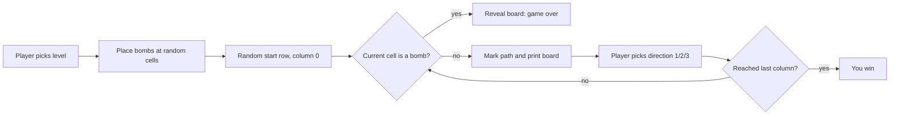

# 💣 Minesweeper Path (C)


A terminal game written in C, built for an elective programming course at university.
Cross a 15×15 minefield from the left edge to the right edge without stepping on a hidden bomb.

## Why I built this

This was a course assignment to practice the fundamentals of structured programming in C:
2D arrays, loops, conditionals, user input and pseudo-random number generation.
I keep it here as a record of where my programming journey started.

## How to play

1. Choose a difficulty level: `1` (10% of cells are bombs), `2` (20%) or `3` (30%).
2. You start at a random row on the left edge of the board, marked `[X]`.
3. Every turn, choose your next move:
   - `1` – move right
   - `2` – move diagonally up-right
   - `3` – move diagonally down-right
4. Reach the last column to win. Step on a bomb and the board is revealed (`[*]`) — game over.

The game's on-screen text is in Portuguese, as it was delivered for the course.

```text
[ ][ ][ ][ ][ ][ ][ ][ ][ ][ ][ ][ ][ ][ ][ ]
[X][X][X][ ][ ][ ][ ][ ][ ][ ][ ][ ][ ][ ][ ]
[ ][ ][ ][ ][ ][ ][ ][ ][ ][ ][ ][ ][ ][ ][ ]
...
Escolha a direcao da proxima jogada - digite 1 para andar para direita, ...
```

## How it works



The board is a `15×15` integer matrix: `0` = empty, `1` = bomb, `-1` = visited path.
The code is split into small functions for input, bomb placement and board printing.

## Tech stack

| Item | Choice |
| --- | --- |
| Language | C (C99) |
| Compiler | GCC or Clang |
| Build | Make |
| CI | GitHub Actions (build with GCC and Clang + scripted smoke test) |

## Getting started

Requirements: a C compiler (`gcc` or `clang`) and `make`.

```bash
git clone https://github.com/rafauto/minesweeper-c.git
cd minesweeper-c
make
./minesweeper
```

Without `make`:

```bash
gcc -std=c99 -Wall -Wextra -O2 -o minesweeper src/campo_minado.c
```

## Project structure

```text
minesweeper-c/
├── src/campo_minado.c        # the whole game
├── Makefile
├── .github/workflows/ci.yml  # build + smoke test
├── LICENSE
└── README.md
```

## From course version to today

The original assignment is preserved in the first commit and in the
[`v1.0-course`](https://github.com/rafauto/minesweeper-c/tree/v1.0-course) tag.
The current version keeps the same gameplay and fixes what I would do differently now:

| Issue in the course version | Fix |
| --- | --- |
| `rand() % 14` never placed bombs on the last row or column | Uses the full `0–14` range |
| Diagonal moves could leave the board and read outside the array | Moves off the board are rejected |
| Reaching the last column always won, even on a bomb | The last cell is checked like any other |
| An invalid difficulty level let the game continue | Level and direction are validated and asked again |
| Bombs could overlap, so fewer were placed than intended | Exactly 10%, 20% or 30% of cells get a bomb |
| The start cell could be a bomb | The start cell is always safe |
| Everything in one `main()` with repeated printing code | Small functions (`read_int_in_range`, `place_bombs`, `print_board`) and named constants |

CI now builds with `-Werror` on GCC and Clang and tests input validation.

## License

MIT — see [LICENSE](LICENSE).

## Author

**Rafaela Uto** — [GitHub](https://github.com/rafauto)
